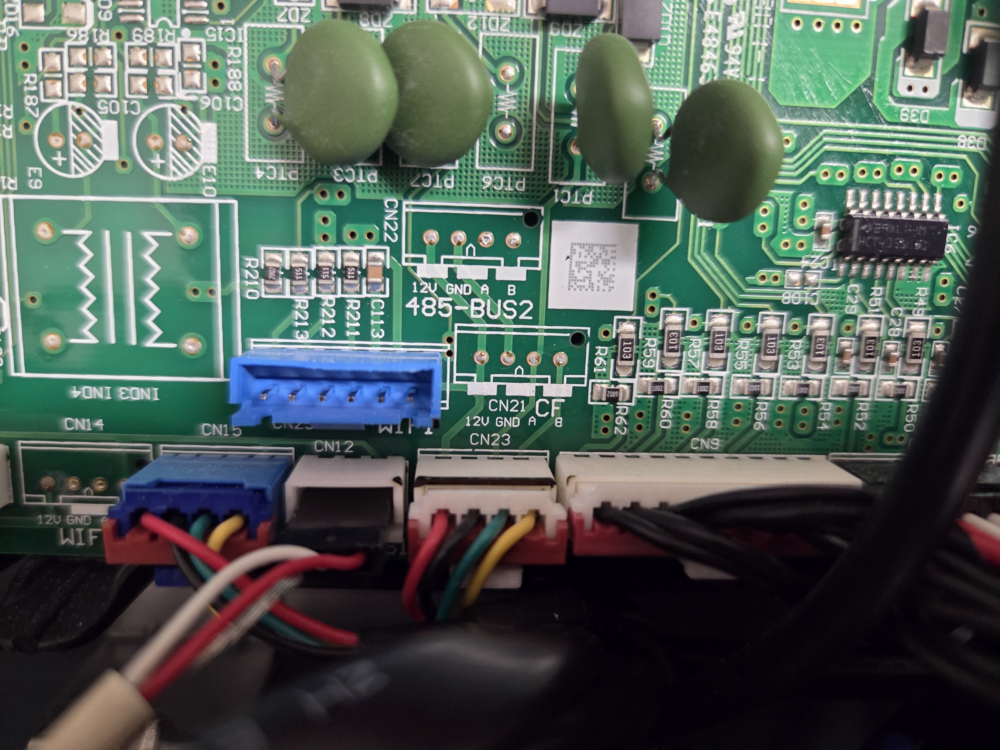
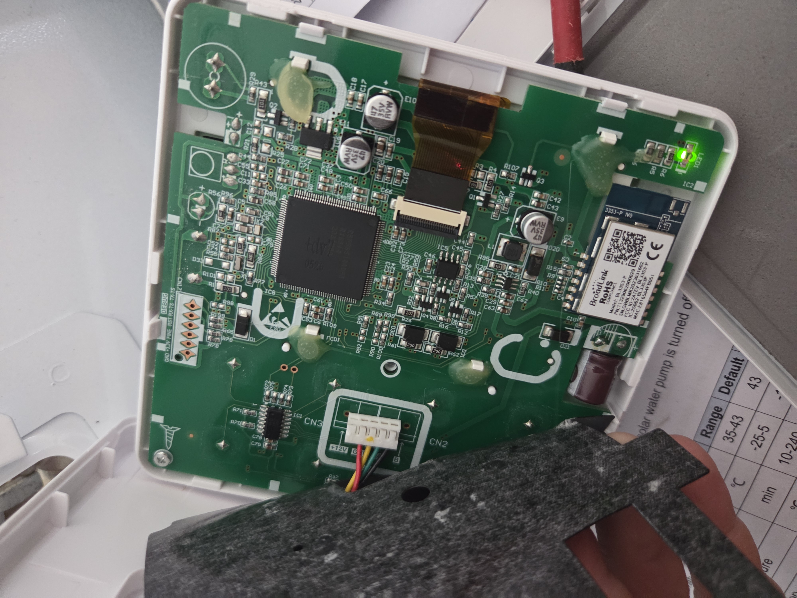
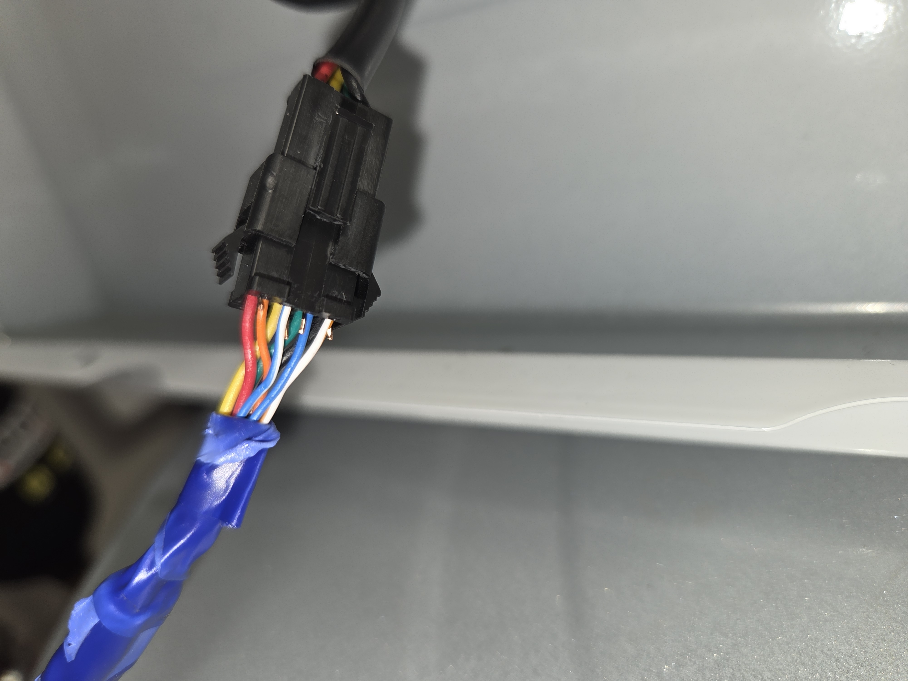
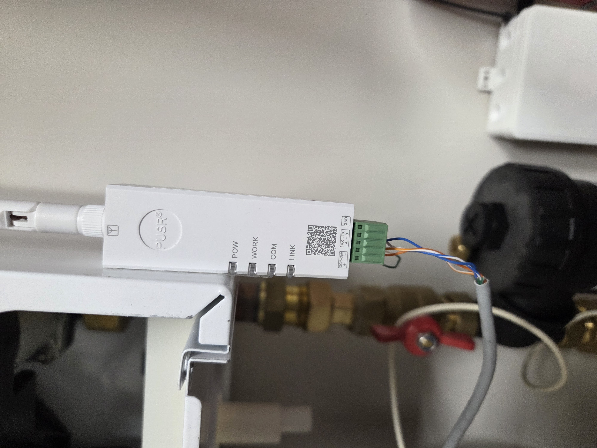
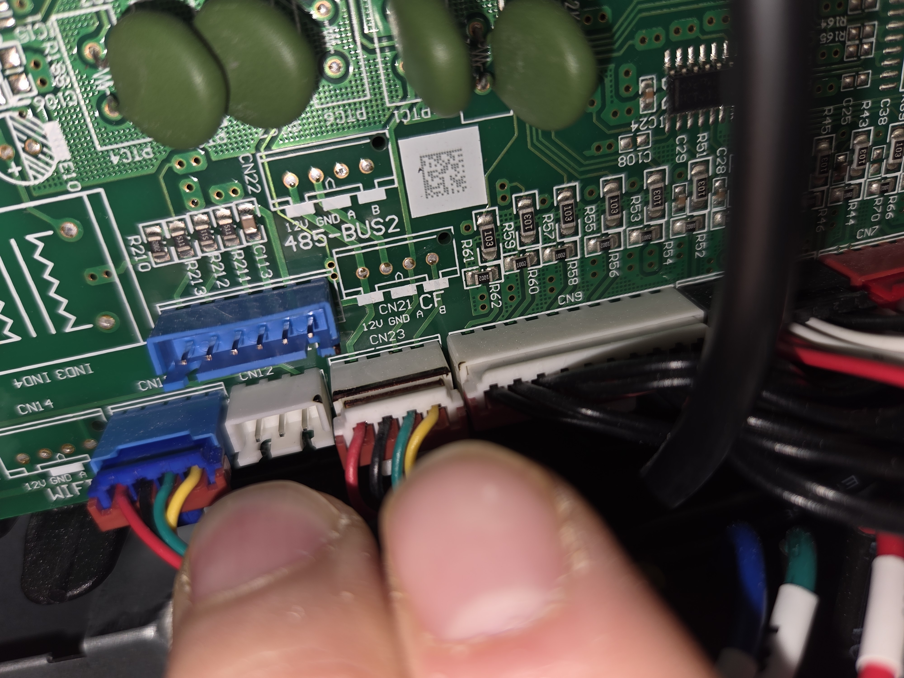

# AUX ACHP-H08 Local

Local Home Assistant integration for AUX ACHP-H08 R32 heat pumps using the native RS485 protocol and a transparent TCP gateway. No AUX Cloud, MQTT or ESPHome required.

Developed with an **AUX ACHP-H08/4R3HA-I** and a **USR-DR164**.

## Features

- Temperatures: outdoor, suction/discharge, heat exchanger, inverter, refrigerant inlet/outlet, water inlet/outlet, DHW tank, buffer, IBH outlet and FLH inlet.
- Operating data: water flow, currents, DC voltage, fan speed and expansion valve position.
- Valve, circulation pump and electric heater states.
- **Defrost** in Sensors; supported by one HMI-confirmed cycle and five additional matching recorded cycles.
- Heating and DHW ON/OFF, both target temperatures, Fast hot water and a heating thermostat.
- Mapped service settings, firmware dates and last received settings timestamp.
- Polish/English entity names, selectable on the device page.

The heating thermostat displays **FLH W-IN water temperature**, not room temperature.

## Installation

### HACS custom repository

1. Open HACS > menu > Custom repositories.
2. Add `https://github.com/piotrek7700/ha-aux-heatpump-local` with type **Integration**.
3. Download **AUX ACHP-H08 Local** and restart Home Assistant.
4. Go to Settings > Devices & services > Add integration > **AUX ACHP-H08**.
5. Enter your RS485-to-TCP gateway's IP address and port.

This repository is a custom HACS repository; it is not listed in the default HACS catalogue.

### Manual installation / update

Copy `custom_components/aux_heatpump` into `/config/custom_components/` and restart Home Assistant. In Docker, restart the Home Assistant container.

When updating, replace the integration files and keep the existing integration entry and `.storage` data. Existing entity IDs are preserved.

## Gateway settings

| Setting | Value |
| --- | --- |
| Mode | Transparent TCP Server |
| Serial | 9600 baud, 8 data bits, no parity, 1 stop bit |
| Modbus conversion | OFF |
| Heartbeat | OFF |
| USR pack interval | 20 ms |
| USR TCP timeout | 0 |
| TCP port | 8899 in the author's setup; enter your configured port |

The protocol uses frames beginning with `0x7E`; this is **not Modbus RTU**.

## Where I connected the gateway

I tested **CN12 on the main board (GND, A, B)** and a **parallel connection to the HMI cable**. I used the HMI connection in the pictured setup because it also provides **+12 V**.

Connect RS485 A/B and the required reference/power terminals according to your gateway and board markings. Verify voltage and terminal labels on your own hardware; the photos document this installation, not a universal pinout. Disconnect power before working inside the unit.

### Main board / CN12

More connection photos: main board, HMI cable and gateway

Main-board connectors and the HMI cable:

Parallel splice into the HMI cable:

USR gateway and its wiring:

HMI connector and wire colours:

## Controls and compatibility

- Controls require a previously received **E2 settings frame** and fresh telemetry. If no E2 is stored, change a target temperature once on the HMI and allow reception. Writes stay blocked if no compatible E2 arrives.
- The last observed settings frame is saved across restarts. Fast hot water requires DHW permission ON before it can be enabled.
- Heating/DHW switching and temperature control were confirmed on the author's TCP setup with the 0.6.6 control implementation retained in 1.0.7.
- Version 1.0.3 accepts different hydraulic-frame lengths following **lukaszer1's older-firmware finding** (JW 2022-12-12 / JZ 2022-12-09). His missing-E2 control issue is separate and is not fixed by this change.
- Pressure is an empirical estimate over approximately **536–3984 kPa**; the lower segment is interpolated from the new 536 kPa point to the existing curve. Compressor frequency roles remain experimental.
- Active disinfection and the GAZ/external heat-source request are not confirmed mappings. Energy consumption is not mapped.
- Settings are polled periodically. Disable the integration entry to stop its communication; disabling control entities alone does not stop polling.

## Diagnostic frame recording

On the device page under **Diagnostics**:

- **Record frames (7 days)** starts local recording; **Stop frame recording** stops it.
- **Frame recording** shows whether recording is active, the deadline, last written frame and any errors.
- **Download recordings** creates a ZIP and shows a notification with a download link valid for 10 minutes. Recording can continue during export.

Files are saved in `/config/aux_heatpump_captures/<entry_id>/`. Only received CRC-valid frames are recorded, with UTC timestamps. Recording itself sends no commands and resumes after a Home Assistant restart until its original deadline.

Raw recordings rotate at **512 MiB per device**, keeping the newest files. One download ZIP (and temporary space while building it) uses additional disk space. Files stay local and are not uploaded automatically.

## Mapping

[Excel mapping table](docs/AUX-ACHP-H08-Mapping-EN.xlsx) · [CSV mapping table](docs/AUX-ACHP-H08-Mapping-EN.csv)

The table is the 1.0.0 reference. Its B-frame length `2D` describes the original captures; 1.0.3 accepts other lengths while keeping field offsets unchanged. Pressure in 1.0.4 uses signed A7–A8 and a lower-range interpolation; the raw diagnostic remains unsigned.

## Release notes

- **1.0.7** — Moved Defrost to Sensors; uncertainty notes are in entity attributes, with existing entity IDs preserved.
- **1.0.6** — Added seven-day diagnostic frame recording, stop/status controls and ZIP download.
- **1.0.5** — Added the read-only Defrost (candidate) diagnostic entity.
- **1.0.4** — Fixed unavailable low-pressure readings by interpreting the pressure word as signed; added the 536 kPa calibration point.
- **1.0.3** — Different hydraulic-frame lengths; fix reported by lukaszer1.
- **1.0.2** — Language selector moved to Controls.
- **1.0.1** — Added System/Polish/English entity-name selection.
- **1.0.0** — Polish/English translations and English mapping table.
- **0.6.6** — Improved heating/DHW control and DHW permission feedback.

## Credits and licence

Created by [piotrek7700](https://github.com/piotrek7700). Thanks to [lukaszer1](https://github.com/maeek/ha-aux-cloud/discussions/89#discussioncomment-19454813) for the older-firmware compatibility fix and to the original discussion participants for testing.

MIT licence. Community reverse-engineering project, unaffiliated with AUX.
